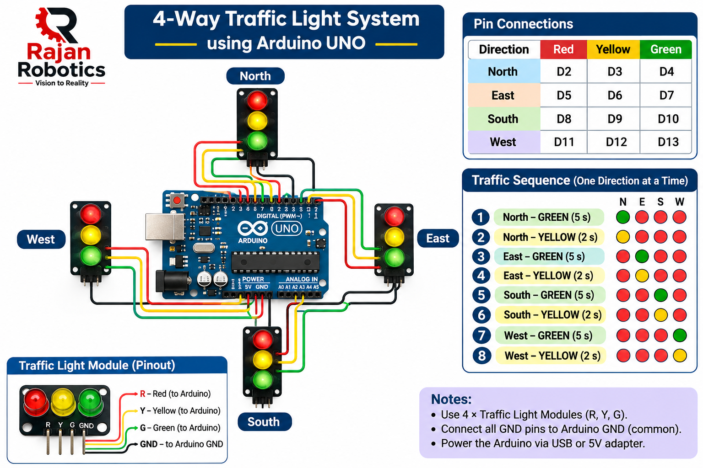

hi🚦 Project Overview

The Arduino-Based 4-Way Traffic Light Control System is a beginner-friendly electronics and embedded systems project developed by Rajan Robotics.

This project demonstrates how an Arduino UNO can control four traffic signal modules representing the North, South, East, and West directions of a road intersection.

The system operates in a sequential manner. One direction receives a GREEN signal while the remaining three directions display RED. A YELLOW signal indicates the transition before the next direction gets permission to move.

🎯 Project Objectives

- Understand Arduino digital input/output operations.
- Learn traffic signal sequencing.
- Explore embedded C programming.
- Understand real-world traffic signal control logic.
- Develop practical electronics and prototyping skills.

Developed by: Rajan Robotics
Tagline: Vision to Reality

*Figure 1: Arduino-Based 4-Way Traffic Light Prototype developed by Rajan Robotics.*

🧰 Components Required

The following components are used to build the 4-way traffic light prototype.

S.No.| Component| Quantity
1| Arduino UNO| 1
2| 3-LED Traffic Light Module (Red, Yellow, Green)| 4
3| Mini Breadboard| 4
4| Male-to-Male Jumper Wires| As required
5| USB Cable| 1
6| Computer with Arduino IDE| 1

🛠️ Software Requirements

- Arduino IDE
- Arduino UNO Board Package
- USB Driver (if required)

Note: The Arduino UNO is powered through USB or a suitable 5V supply. Check whether the traffic-light modules have built-in current-limiting resistors.

🔌 Circuit Connections

Each traffic-light module has three control inputs:

- Red (R)
- Yellow (Y)
- Green (G)

Arduino UNO Pin Mapping

Direction| Red| Yellow| Green
North| D2| D3| D4
East| D5| D6| D7
South| D8| D9| D10
West| D11| D12| D13

Common Connections

- Connect all module GND pins to Arduino GND.
- Connect each signal input to its corresponding Arduino digital pin.
- Connect Arduino UNO to the computer using a USB cable.

Important

Verify the traffic-light module pinout before connecting. If the modules do not have built-in current-limiting resistors, use suitable external resistors for the LEDs.

Controller: Arduino UNO
Number of traffic-light modules: 4
Total signal outputs: 12

⚙️ Working Principle

The system controls four traffic signals independently: North, East, South, and West.

The traffic lights operate sequentially, allowing only one direction to receive a GREEN signal at a time. The remaining three directions display RED.

🚦 Traffic Signal Sequence

The traffic signals operate in the following order:

1. North – GREEN (5 seconds)

- North: GREEN
- East, South, West: RED

2. North – YELLOW (2 seconds)

- North: YELLOW
- East, South, West: RED

3. East – GREEN (5 seconds)

- East: GREEN
- North, South, West: RED

4. East – YELLOW (2 seconds)

- East: YELLOW
- North, South, West: RED

5. South – GREEN (5 seconds)

- South: GREEN
- North, East, West: RED

6. South – YELLOW (2 seconds)

- South: YELLOW
- North, East, West: RED

7. West – GREEN (5 seconds)

- West: GREEN
- North, East, South: RED

8. West – YELLOW (2 seconds)

- West: YELLOW
- North, East, South: RED

Key Features

- Independent control of four traffic signals.
- Three RED signals remain ON while one direction is active.
- Automatic sequential operation.
- Adjustable GREEN and YELLOW timings.
- Simple Arduino-based control logic.

## 💻 Source Code

The complete Arduino program is available here:

[Download Arduino Source Code](traffic_light_control.ino)

🌍 Applications

This project can be used for:

- Understanding basic traffic signal control systems.
- Arduino and embedded systems learning.
- Electronics and robotics laboratory demonstrations.
- STEM education for school students.
- Practical programming exercises for engineering students.
- Demonstrating sequential control logic.

🚀 Future Improvements

The project can be upgraded with the following features:

1. Pedestrian Crossing: Add push buttons and pedestrian signals.
2. Countdown Timer: Display the remaining time for each signal.
3. Vehicle Detection: Use IR or ultrasonic sensors to detect vehicles.
4. Emergency Vehicle Priority: Give priority to ambulances and emergency vehicles.
5. Smart Traffic Management: Use ESP8266 or ESP32 for IoT-based monitoring.
6. Adaptive Traffic Control: Adjust signal timing based on vehicle density.

---

👨‍💻 Developed By

**Rajan Robotics**

Vision to Reality

Empowering students through practical learning in Robotics, Electronics, Embedded Systems and IoT.

📧 GitHub: "Rajan Robotics" (https://github.com/rajanrobotics05-RR)

⭐ If you find this project useful, don't forget to give it a star!
